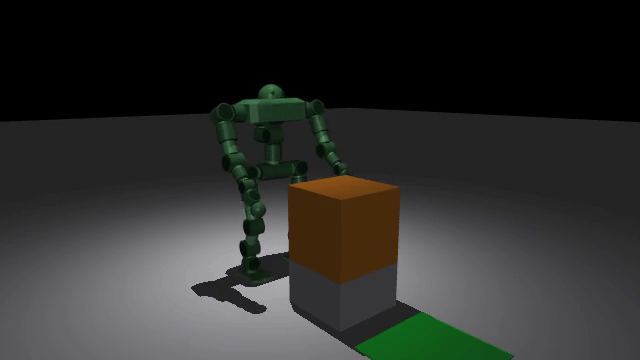
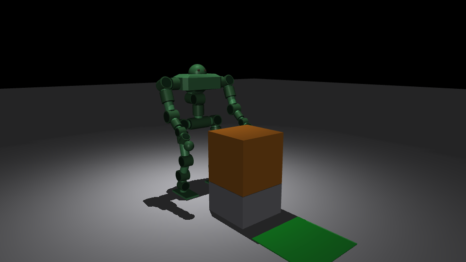
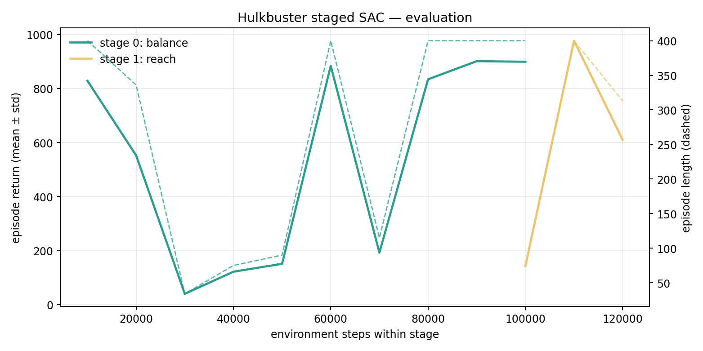
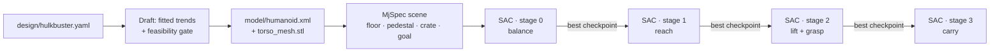

<div align="center">

# HULKBUSTER

### A 126 kg humanoid that learns to stand, reach, and carry in MuJoCo

**29 actuated joints · 125.8 kg · 1.29 m tall · staged soft actor-critic**

[](https://www.python.org/)
[](https://mujoco.org/)
[](https://stable-baselines3.readthedocs.io/)
[](LICENSE)



*Stage 1: balance and reach. The crate is a 0.5 m, 12 kg cube on a 0.30 m pedestal.*

</div>

---

## What this is

A heavy humanoid is not a small quadruped with a taller mesh. It has long load
paths, large reflected actuator inertia, and enough mass that a few centimetres
of centre-of-pressure error tips it over. This repo is a deliberately small,
reproducible testbed for that problem: a procedurally generated **Hulkbuster**
built with [Draft](https://github.com/davidhnguyen2000/draft), then trained in
MuJoCo with a four-stage SAC curriculum.

The robot is defined by one YAML file. Draft's fitted trends fill in the
actuator masses, link densities, and clearances, and its feasibility gate checks
the result against catalogued hardware. The generated MJCF is committed here, so
the repo runs without the Draft checkout.

| | |
|---|---|
| **Mass** | 125.836 kg |
| **Height** | 1.29 m (z-span) |
| **Joints** | 29 actuated hinges |
| **Actuators** | L / M / S: **450 / 220 / 80 N·m** |
| **Stance** | 0.25 m hip width, 0.50 m shoulder width |
| **Feet** | 0.30 × 0.16 m, flat soles |
| **Control** | 50 Hz policy, 500 Hz physics |
| **Task** | 0.5 m, 12 kg crate on a 0.30 m pedestal |

<div align="center">

</div>

---

## Results

A single **smoke run** of 100k steps per stage, evaluated deterministically over
five episodes with no pushes. These are baseline numbers, not a polished
locomotion result; the best checkpoint is reported because SAC is unstable late
in a stage.

| Stage | Task | Best eval return | Mean length | Success | Grasp | Min hand ↔ crate | Max crate z |
|---:|---|---:|---:|---:|---:|---:|---:|
| 0 | balance | **900.9** | 400 / 400 | 0% | 0% | 0.537 m | 0.551 m |
| 1 | reach | **976.6** | 400 / 400 | 0% | 0% | **0.477 m** | 0.551 m |
| 2 | lift | *training* | — | — | — | — | — |
| 3 | carry | *training* | — | — | — | — | — |

**Success** means the crate reached the goal; it is the final-task metric, so it
is 0 for stages 0 and 1. **Grasp** is the weld trigger and is only active from
stage 2. The hand distance starts at 0.537 m; the grasp threshold is **0.45 m**.
Stage 1 gets to 0.477 m — 27 mm short.

<div align="center">

</div>

### What works

- **Stage 0 stands for the full 8 s episode** (400/400 steps) with flat feet,
  zero drift, and no self-collision at reset. The nominal stance is statically
  stable by construction: `ankle = -(hip + knee)`.
- **Stage 1 learns a reach**: the minimum hand-to-crate distance drops from
  0.537 m to **0.477 m** while staying upright for the full episode.
- The robot is **feasible against fitted actuator trends**: the L-class 450 N·m
  unit is priced at 3.82 kg and sits inside the catalogued torque-density p90.
- The whole pipeline — parameters → MJCF → scene → policy → video — is
  deterministic and rerunnable from the files in this repo.

### What does not work yet

- **No lift or carry.** Stage 2/3 are still training; the 27 mm reach gap is
  exactly the kind of thing the next stage must close.
- **The grasp is a weld**, not fingers. When both hand sites are within 0.45 m
  of the crate, a weld equality attaches the crate to the torso at its current
  relative pose. The policy learns approach and lift, not dexterous grasping.
- **No sim-to-real claim.** There is no actuator latency, sensor noise, or
  domain randomization beyond initial-state noise and occasional pushes.
- The staged SAC is **brittle**: stage 1 peaked at 976.6 at 110k steps and fell
  to 609.7 at 120k. The repo therefore ships the best checkpoint, not the last.

---

## How it works



### Observation, action, reward

- **Observation (109 dims):** root height, quaternion, and velocities; all joint
  positions/velocities; previous action; crate-to-hand vectors in the torso
  frame; crate height; goal vector; grasp flag.
- **Action (29 dims):** normalized offsets around the nominal joint pose. A PD
  position actuator per joint uses `kp = 5 × effort` and `kv = 0.3 × effort`;
  gravity compensation is applied as `qfrc_bias`.
- **Reward:** added cumulatively by stage — upright/alive, low root velocity,
  hand-to-crate proximity, crate lift, goal proximity, and a small penalty on
  mean squared actuator force. A fall ends the episode with `-5`.
- **Grasp:** a weld equality `torso_link ↔ crate` is enabled at stage ≥ 2 when
  both hand sites are inside `GRASP_RADIUS = 0.45 m`.

### Curriculum

| Stage | Goal | Key reward terms |
|---:|---|---|
| 0 | Stand under pushes | upright, height, low velocity, action smoothness |
| 1 | Reach both hands to the crate | hand distance, upright, low force |
| 2 | Lift and hold | crate height, grasp, upright, low force |
| 3 | Carry to the goal | goal distance, crate height, upright |

Each stage warm-starts from the previous stage's **best** checkpoint.

---

## Run it

```bash
git clone https://github.com/rubikscube05/hulkbuster-rl.git
cd hulkbuster-rl
python -m venv .venv
source .venv/bin/activate
pip install -r requirements.txt
```

Evaluate the shipped policies:

```bash
python evaluate.py --model models/stage0_best.zip --stage 0 --episodes 5
python evaluate.py --model models/stage1_best.zip --stage 1 --episodes 5
```

Render a replay (headless machines need EGL):

```bash
MUJOCO_GL=egl python record_video.py \
  --model models/stage1_best.zip --stage 1 \
  --out assets/replay.mp4 --gif assets/replay.gif
```

Render the design still:

```bash
MUJOCO_GL=egl python render_still.py --out assets/design.png
```

Retrain the whole curriculum (4 × 100k steps, CPU is enough):

```bash
bash run_smoke.sh
# override: TIMESTEPS=200000 ENVS=8 bash run_smoke.sh
```

`run_smoke.sh` trains each stage, evaluates its best checkpoint, writes an MP4
and GIF, and plots the evaluation curves. Video rendering is non-fatal if EGL
is unavailable. Training logs to `runs/smoke/`.

### Video notes

MuJoCo's default offscreen framebuffer is 640×480. `record_video.py` sets the
model's `offwidth/offheight` to at least 1280×720, so 960×540 stills work; the
replays here are 640×360 at 50 fps. If EGL fails, try `MUJOCO_GL=osmesa` or run
with a display.

### Design generation

The committed `model/humanoid.xml` and `torso_mesh.stl` are the output of:

```bash
python scripts/generate_robot.py --robot humanoid \
  --overrides experiments/humanoid_variants/hulkbuster.yaml \
  --output-dir generated/hulkbuster --fixed-output-dir
```

in a Draft checkout. The override file is reproduced at
[`design/hulkbuster.yaml`](design/hulkbuster.yaml); the feasibility report is at
[`design/feasibility_report.yaml`](design/feasibility_report.yaml).

---

## Repository layout

```text
.
├── env.py                  # MjSpec scene, actuators, rewards, grasp
├── train_sac.py            # staged SAC trainer
├── evaluate.py             # deterministic evaluation → JSON
├── record_video.py         # policy rollout → MP4/GIF
├── render_still.py         # design still
├── plot_training.py        # EvalCallback curves
├── run_smoke.sh            # 4 × 100k staged run
├── model/
│   ├── humanoid.xml        # generated robot
│   └── torso_mesh.stl
├── design/
│   ├── hulkbuster.yaml     # design overrides
│   ├── feasibility_report.yaml
│   └── parameters_resolved.yaml
├── models/
│   ├── stage0_best.zip
│   └── stage1_best.zip
├── results/
│   ├── stage0.json
│   └── stage1.json
└── assets/
    ├── design.png
    ├── stage0.gif / .mp4
    ├── stage1.gif / .mp4
    ├── training_curve.png
    └── reference.jpeg
```

---

## Limitations

This is a **baseline**, not a finished robot policy. The interesting failure is
the last 27 mm: a policy can look stable, score well, and still be unable to
close a grasp. The next steps are a real contact-rich grasp, lift/carry rewards
that survive SAC's late-stage collapse, and domain randomization over actuator
strength, latency, and friction before any hardware claim.

The reference image in `assets/reference.jpeg` is included for design context;
the generated robot is defined entirely by `design/hulkbuster.yaml`.

## Credits

- [Draft](https://github.com/davidhnguyen2000/draft) — parametric robot
  generation, fitted actuator trends, and the feasibility gate.
- [MuJoCo](https://mujoco.org/) — physics and rendering.
- [Stable-Baselines3](https://stable-baselines3.readthedocs.io/) — SAC.

MIT licensed. See [LICENSE](LICENSE).
